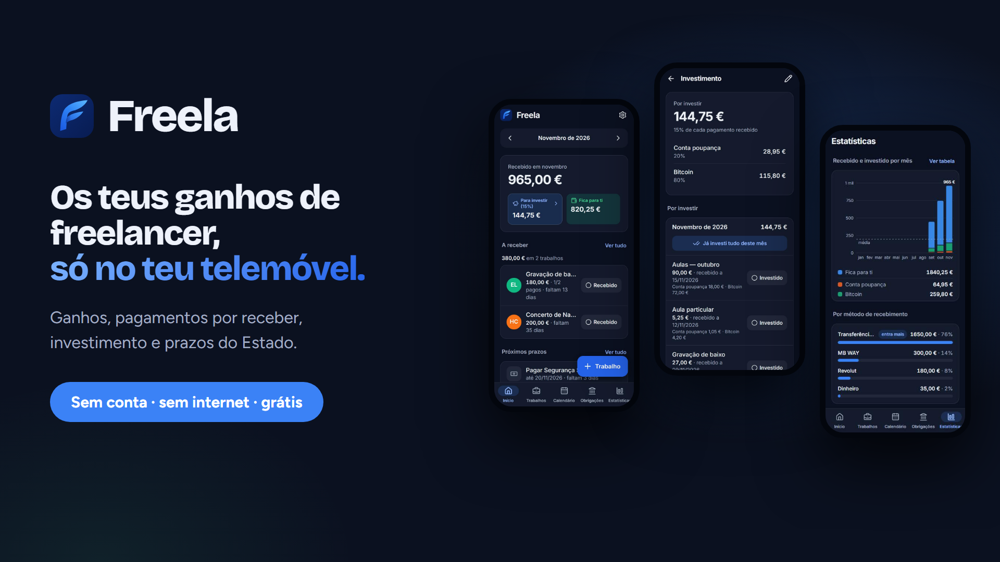
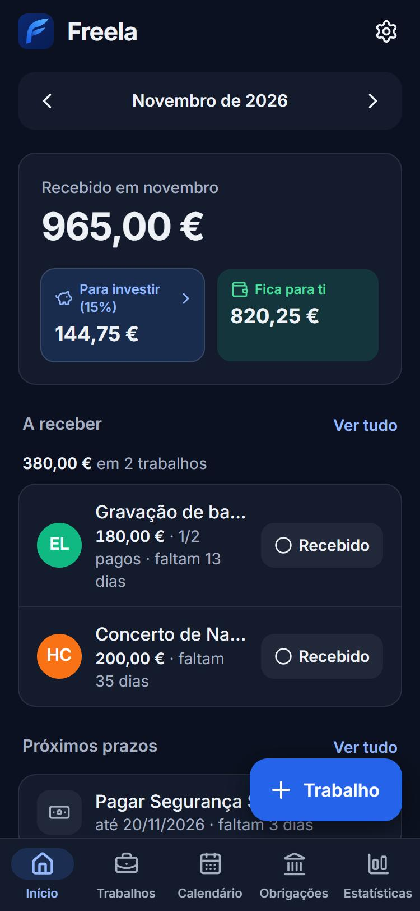
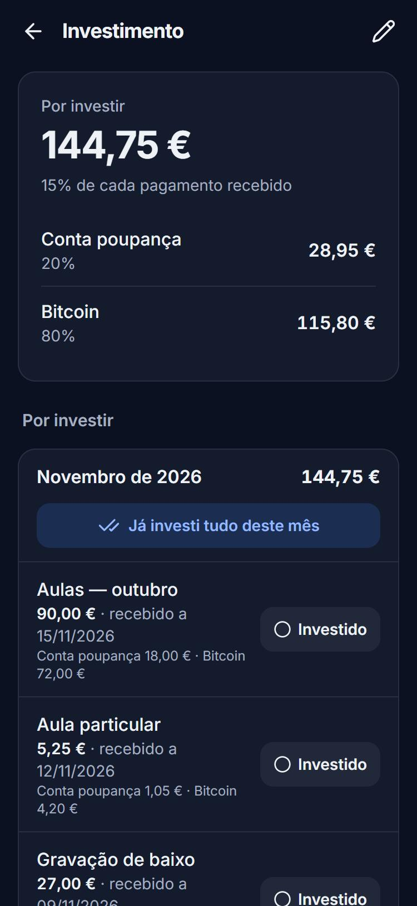
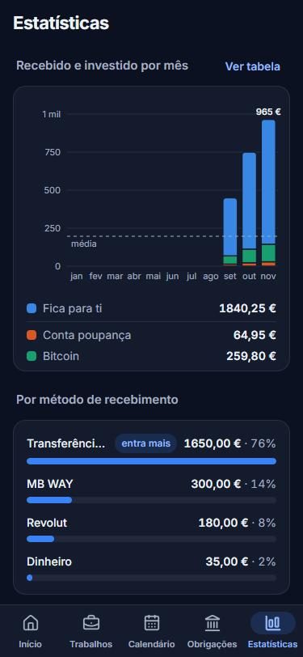

<div align="center">



**App Android sem conta e sem internet, para registar o que ganhas, o que ainda tens por receber, quanto vai para investir e os prazos do Estado.**

<a href="https://bacoinz.github.io/freela/"></a> <a href="https://github.com/bacoinz/freela/releases/latest"></a> <a href="LICENSE.md"></a>  <a href="https://ko-fi.com/bacoinz"></a>

[Site](https://bacoinz.github.io/Free/) · [Descarregar](https://github.com/bacoinz/freela/releases/latest) · [Instalar](docs/COMO-INSTALAR.md) · [☕ Ko-fi](https://ko-fi.com/bacoinz)

</div>

> [!NOTE]
> **A interface está só em português de Portugal.** As capturas usam dados de exemplo.

## O que faz

- **Trabalhos e prestações**: pagamento de uma vez, em 2 vezes ou personalizado («450 € · 1/2 pagos · falta 225 €»). Cada pagamento fica pendente até marcares «recebido».
- **Pagadores e métodos**: pagadores guardados (cada um com a sua cor) ou avulsos, e a forma de pagamento (transferência, MB WAY, Revolut, dinheiro).
- **Rendimento fixo mensal**: por exemplo as aulas numa escola, criadas sozinhas todos os meses, no próprio mês ou pagas no mês seguinte.
- **Investimento**: uma percentagem de cada pagamento recebido, dividida por destinos à tua escolha (ex.: 20% conta poupança, 80% bitcoin). Marcas como investido por trabalho, pagamento ou mês; uma mudança de percentagem ou de divisão só conta a partir do mês atual.
- **Prazos do Estado**: Segurança Social, declaração trimestral, e-Fatura e IRS, com lembretes e ícone à escolha, mais os teus próprios prazos.
- **Calendário** do que recebeste, do que está previsto e dos prazos.
- **Estatísticas**: melhor e pior mês, recebido e investido por mês (com cada destino numa cor), por método, tipo de trabalho e pagador.
- **Privada**: sem conta e sem permissão de internet. Os dados ficam só no telemóvel, com bloqueio por impressão digital, cópias diárias em `Documentos/Freela` e exportação para Excel (CSV).

## Capturas

<div align="center">

  

<sub>Início, Investimento e Estatísticas, com dados de exemplo.</sub>

</div>

## Instalar

1. No telemóvel, descarrega a APK da [última versão](https://github.com/bacoinz/freela/releases/latest).
2. Abre o ficheiro. Se o Android pedir, permite «instalar apps desconhecidas»; se o Play Protect avisar, escolhe «Instalar mesmo assim».
3. Para atualizar, instala a APK nova por cima: **os dados mantêm-se**. Não desinstales a app, porque isso apaga os dados.

Precisa de Android 7 ou mais recente. O guia completo, incluindo compilar a APK a partir do código, está em [docs/COMO-INSTALAR.md](docs/COMO-INSTALAR.md).

## Compilar a partir do código

É feita com React, Vite e Tailwind e empacotada com Capacitor 8. Para a testar no browser do PC:

```bash
npm install
npm run dev
```

| Comando | O que faz |
|---|---|
| `npm run dev` | Abre a app no browser do PC (<http://localhost:5173>) |
| `npm test` | Testes automáticos (Vitest) |
| `npm run build` | Build da web-app (verifica os tipos) |
| `npm run apk` | Gera a APK assinada em `release/` (precisa do Android SDK, do Java 21 e de uma chave de assinatura tua) |
| `npm run apk:install` | Instala/atualiza a APK no telemóvel ligado por USB |

## Organização

- `src/domain/`: regras e cálculos (TypeScript puro, testado): prestações, investimento, rendimentos fixos, prazos e lembretes, estatísticas.
- `src/data/`: armazenamento (ficheiro privado no Android, `localStorage` no browser), cópias de segurança, notificações e bloqueio.
- `src/ui/`: ecrãs e componentes.
- `android/`: projeto Android gerado pelo Capacitor (manifest sem internet nem backup na cloud).
- `site/`: a página do GitHub Pages.

## Apoiar

A Freela é gratuita. Se te for útil, podes [pagar-me um café no Ko-fi](https://ko-fi.com/bacoinz).

## Licença

[PolyForm Noncommercial 1.0.0](LICENSE.md): podes usar, mudar e correr à vontade para ti, de graça. Vender a app, ou o acesso a ela como serviço, não é permitido. Para uso comercial, fala com o autor.
